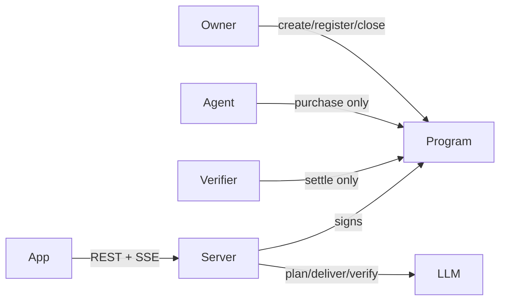

# Mandate

Pay for proof, not promises. An owner signs a small purchase plan. An agent may only `purchase` inside it. A verifier is the only key that `settle`s. Payment follows a verified score, not the seller’s claim. Token is our own devnet SPL mint, **dUSDC** (6 decimals).

Solana Hackathon · AI Track. Devnet only. No mainnet funds.

Spec and task board came from the [Assay](https://cursor.com/agents/bc-c4f7a084-4ef7-461f-aa28-65d0bc7c282a) cloud agent. **This repo is the real build** — local Vite UI, Anchor program, Node server. An old Base44 mock was layout inspiration only.

## Read these first

1. [`docs/composer-build-plan.md`](docs/composer-build-plan.md) — gated build (A → F)
2. [`notes.md`](notes.md) — MND task board
3. [`docs/ui-audit.md`](docs/ui-audit.md) — what the mock faked vs live mode

## Layout

```
app/        Vite + React (Mission Control, Attack Lab, Setup, Providers, Receipts)
program/    Anchor 0.32.1 (`programs/mandate`, `tests/mandate.ts`)
server/     Hono + SQLite + SSE + chain clients + engine
scripts/    keys, mint, atas, register, warmup, demo-check
shared/     API types shared with the app
.keys/      gitignored role keypairs (server-only)
```

## Quick start

```bash
npm install
cp .env.example .env   # fill SOLANA_RPC_URL, PROGRAM_ID, DUSDC_MINT, ANTHROPIC_API_KEY after deploy
npm run setup:keys
npm run dev              # server :8787 + app :5173
```

Gate A/B (toolchain + program):

```bash
# Install Solana CLI + Anchor 0.32.1, then:
cd program && anchor test
# deploy to devnet, set PROGRAM_ID in .env, copy fresh IDL to server/src/chain/idl/mandate.json
npm run setup:mint
npm run setup:atas
npm run setup:register
```

## Scripts

| Command | Purpose |
| --- | --- |
| `npm run test:server` | ECS / verify math unit tests |
| `npm run test:program` | Localnet mandate + attack tests |
| `npm run warmup` | 10 real missions (server must be up) |
| `npm run demo:check` | Acceptance checklist |

## Architecture



## Limits (honest)

- Verifier key is team-held (demo).
- LLM “providers” Alpha / Deep / Premium are server prompts, not third-party wallets. Default backend is the Gemini free tier (`LLM_PROVIDER=gemini`, `GEMINI_API_KEY`): Alpha `gemini-3.1-flash-lite`, Deep `gemini-3.5-flash-lite`, Premium and grader `gemini-3.6-flash`. Override any with `MODEL_*`. Set `LLM_PROVIDER=anthropic` to use Claude.
- Alpha is a scripted overclaimer: its system prompt tells it to invent figures. Without that, models recall NVIDIA's real FY2025 numbers and pass the fact check.
- Provider registry is per-owner on chain.
- Default program id in repo is local placeholder until devnet deploy.
- `reclaim_order` (owner cancels an unsettled order after expiry, so a silent verifier cannot lock funds) is in `lib.rs`, the localnet tests and the IDL, but **not yet deployed**. Until the program is upgraded on devnet, recover interrupted runs with `POST /api/recover`, which settles open orders through the normal verifier path.
- Warmup runs real delivery and verification (needs `ANTHROPIC_API_KEY`). It uses its own one-line mandate with a 0.25 research cap so Premium can be bought at its real quote.

## Installing on an exFAT/FAT drive

npm workspaces need symlinks, which exFAT cannot store (`EISDIR ... symlink`). Install each package on its own and point the root scripts at the server's modules:

```bash
npm install --workspaces=false --no-package-lock
for d in server app program; do (cd $d && npm install --workspaces=false --no-package-lock); done
NODE_PATH="$PWD/server/node_modules" npx tsx scripts/keys.ts   # same prefix for any scripts/*.ts
```
