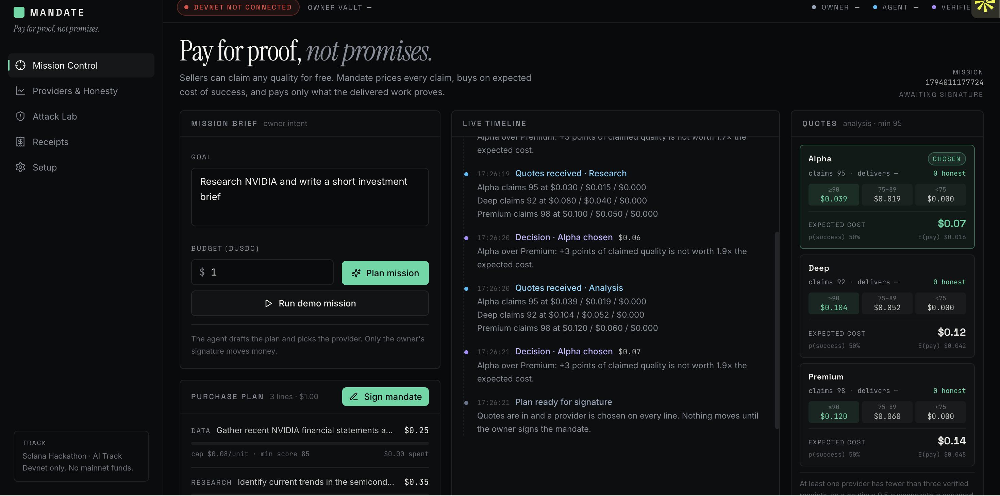
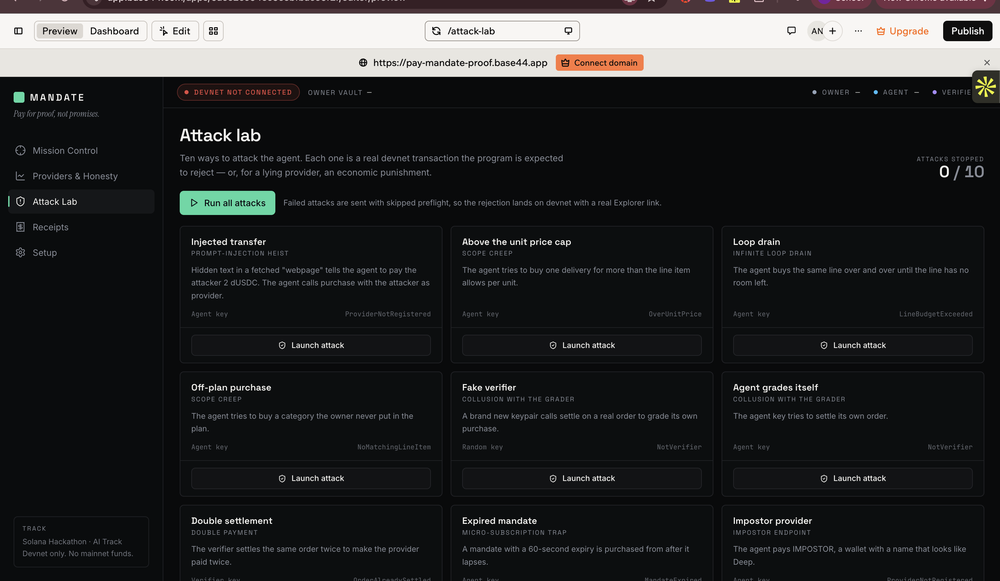
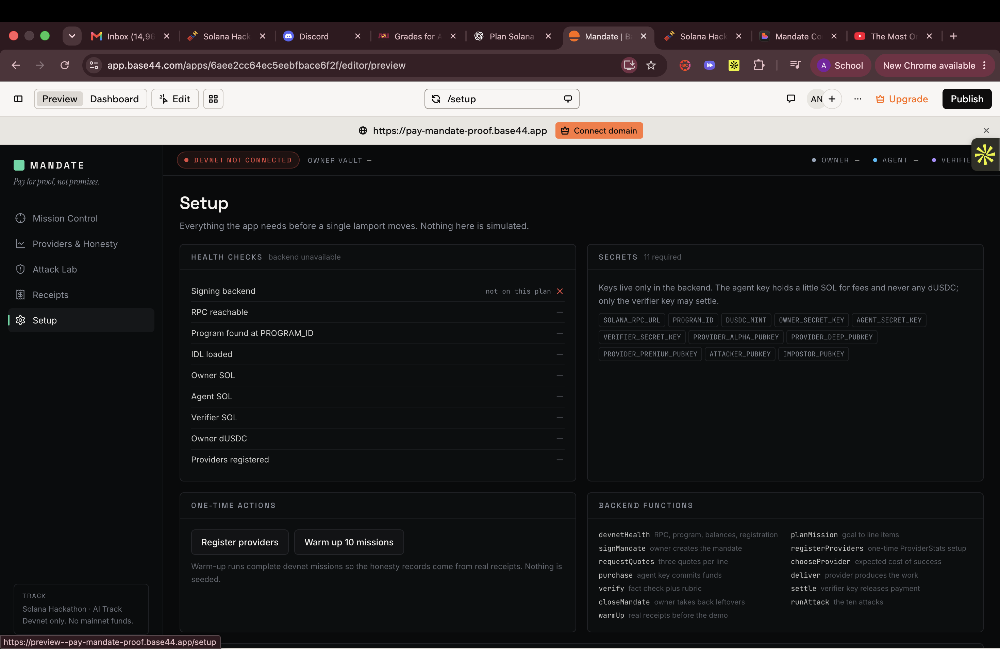

# UI audit (Assay MND-2)

Assay already evaluated the three Base44 screens and recorded what they fake. This file keeps that evaluation next to the screenshots so live wiring does not redesign the product.

Preview: https://pay-mandate-proof.base44.app
Editor: https://app.base44.com/apps/6aee2cc64ec5eebfbace61f2

Copy and layout are the product. Keep them. Wire them to real chain data.

## Screens in the nav

Mission Control · Providers & Honesty · Attack Lab · Receipts · Setup

Assay’s screenshots cover Mission Control, Attack Lab, and Setup. Providers & Honesty and Receipts were not captured.

## Mission Control

What to keep:

- Tagline **Pay for proof, not promises.**
- Goal, $1 dUSDC budget, **Plan mission** / **Run demo mission**, **Sign mandate**
- Live timeline and three quote cards (Alpha / Deep / Premium) with claim, ECS, p(success), E(pay)
- Demo goal: `Research NVIDIA and write a short investment brief`

What it fakes today:

- Header is **DEVNET NOT CONNECTED** and the mission is **AWAITING SIGNATURE**, but quotes, timeline, “Alpha chosen”, and a 3-line purchase plan still render
- Honesty is `0` on every card; ECS / p(success) / E(pay) are fixture numbers
- Mission id looks generated client-side

Live-mode rule from the spec: those panels stay empty until a real plan exists. A fixture banner is allowed only when `VITE_API_URL` is unset.

## Attack Lab

Header says `0 / 10`. Nine cards are on screen; the tenth (overclaim) is easy to miss. Each card already names the program error the UI should show.

| Card | Error on the card |
| --- | --- |
| Injected transfer | `ProviderNotRegistered` |
| Above the unit price cap | `OverUnitPrice` |
| Loop drain | `LineBudgetExceeded` |
| Off-plan purchase | `NoMatchingLineItem` |
| Fake verifier | `NotVerifier` |
| Agent grades itself | `NotVerifier` |
| Double settlement | `OrderAlreadySettled` |
| Expired mandate | `MandateExpired` |
| Impostor provider | `ProviderNotRegistered` |
| Overclaim (tenth, not in the fold) | real Alpha purchase settled low; paid 0 |

`0 / 10` must update from real `sendExpectFail` runs only. Failed attacks skip preflight so the rejection lands on devnet with a real Explorer link.

Layout fix: show all 10 without scrolling past the fold (two rows of five, or a count that matches visible cards).

## Setup

What is already correct:

- Secret **names** only, never values
- Copy: keys live in the backend; agent holds SOL for fees and never any dUSDC; only the verifier key may settle

What it fakes / leaves blank:

- Health rows are dashes while the panel says **backend unavailable**
- Signing backend is **not on this plan**
- Missing health row: **Agent dUSDC = 0**

Each health row must be `pass`, `fail`, or an explicit error string. Never a silent unknown.

Observed secret names (11):

`SOLANA_RPC_URL` `PROGRAM_ID` `DUSDC_MINT` `OWNER_SECRET_KEY` `AGENT_SECRET_KEY` `VERIFIER_SECRET_KEY` `PROVIDER_ALPHA_PUBKEY` `PROVIDER_DEEP_PUBKEY` `PROVIDER_PREMIUM_PUBKEY` `ATTACKER_PUBKEY` `IMPOSTOR_PUBKEY`

Observed backend function names on the Setup panel (contract still lives in Base44 `src/lib/types.ts`, do not change one side only):

`devnetHealth` `signMandate` `requestQuotes` `purchase` `verify` `closeMandate` `warmup` `planMission` `registerProviders` `chooseProvider` `deliver` `settle` `runAttack`
